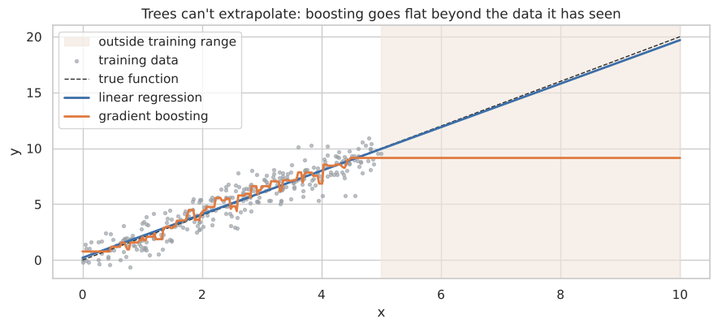

# The Staircase Problem
### When does linear regression beat gradient boosting?

Gradient boosting builds its predictions out of flat steps: a staircase. That makes it great at fitting curves, but it also means it can't continue a trend past the data it has seen.

The usual advice for tabular data is "just use gradient boosting." I wanted to find out when that's actually true, and when plain linear regression is the better pick. I wrote both models from scratch, ran them head-to-head in controlled experiments, and then checked the results on real data.



## What's inside

| Part | What it does |
|---|---|
| 1. Linear regression from scratch | Normal equation + gradient descent in NumPy, matched to scikit-learn |
| 2. Gradient boosting from scratch | Trees fitted to residuals, matched to scikit-learn to within rounding error (~1e-15) |
| 3. Five controlled experiments | Simulated data where the true function is known: shape, dataset size, noise, extrapolation, irrelevant features |
| 4. Real-data validation | Diabetes (442 rows) and Diamonds (53,940 rows), 5-fold cross-validation vs. a mean baseline |
| 5. Decision guide | When to use which model |

## Key findings

- **Shape decides the winner.** On a linear truth, linear regression hits the noise floor (RMSE 1.00) and boosting doesn't (1.20). On a curved truth, boosting wins (1.19 vs 2.02).
- **Trees can't extrapolate.** Outside the training range, boosting's error was **34× higher** than linear regression's, because it predicts a flat line past the data it has seen.
- **Noise and small data favor simplicity.** On a mostly linear truth, boosting wins when noise is low, and linear regression wins once noise is high.
- **Real data agrees.** On the small, noisy Diabetes dataset, linear regression beat boosting (R² 0.49 vs 0.38).
- **Feature engineering closes the gap.** On Diamonds, modeling log(price) from log(carat) raised linear R² from 0.92 to 0.96 *with fewer columns*. Boosting reached 0.98. The log-log model also stays readable: a 10% heavier diamond costs ~20% more.

## Run it

```bash
pip install -r requirements.txt
jupyter notebook linear_vs_boosting.ipynb
```

The notebook runs in about 3–5 minutes on a laptop. Diamonds is downloaded automatically by seaborn, and Diabetes ships with scikit-learn.

## Tools

Python · NumPy · pandas · scikit-learn · matplotlib · seaborn
